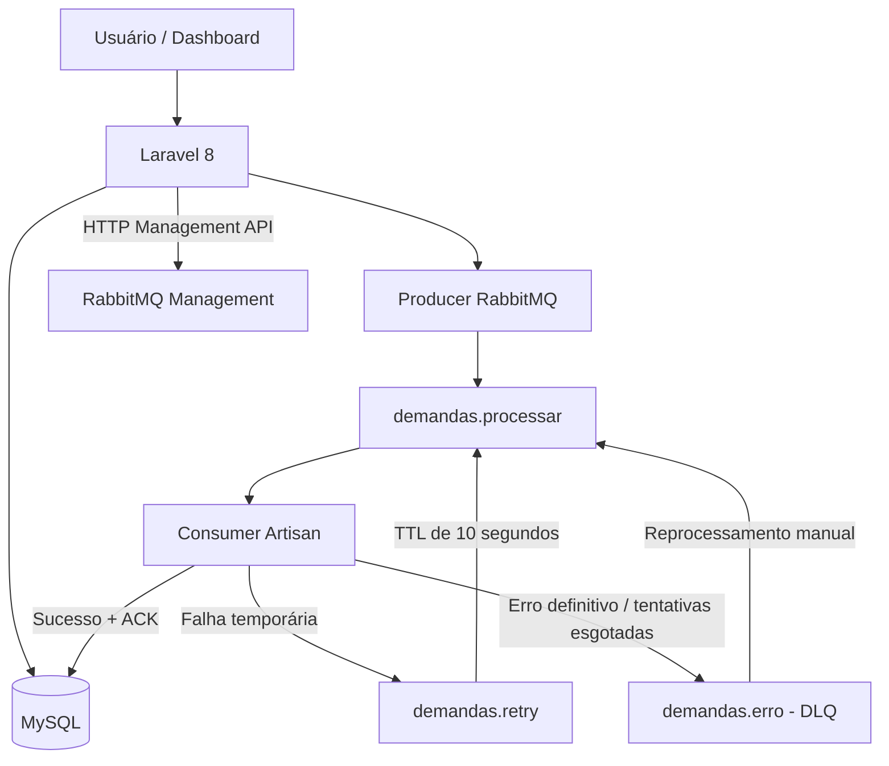

# Gerenciador de Demandas com Laravel e RabbitMQ

Sistema de gerenciamento de demandas desenvolvido com **Laravel 8**, **PHP 8**, **MySQL** e **RabbitMQ**, com foco em processamento assíncrono, tratamento de falhas e monitoramento de filas.

> **Status do projeto:** laboratório funcional / projeto de portfólio. Os fluxos principais foram testados localmente. Ainda não é uma aplicação preparada para produção.

## Visão geral

Ao cadastrar uma demanda, o Laravel grava os dados no MySQL e publica uma mensagem no RabbitMQ. Um *consumer* (worker Artisan) recebe a mensagem e executa o processamento em segundo plano, atualizando o status da demanda. O dashboard consulta o backend periodicamente para mostrar o andamento e os indicadores das filas.

O projeto também demonstra filas de retry, *Dead Letter Queue* (DLQ), reprocessamento e proteção básica contra processamento concorrente da mesma demanda.

## Funcionalidades implementadas

- Cadastro e listagem de demandas usando Laravel, Eloquent e MySQL.
- Publicação de mensagens via `php-amqplib` em `demandas.processar`.
- Worker Artisan `demandas:consumir` com ACK/NACK.
- Retry para falhas temporárias, com até **3 tentativas** (incluindo a inicial) e espera configurada de **10 segundos**.
- DLQ `demandas.erro` para mensagens rejeitadas e tentativas esgotadas.
- Reprocessamento de mensagens da DLQ por comando Artisan e ação no dashboard.
- Controle básico de concorrência por demanda com `GET_LOCK()` / `RELEASE_LOCK()` no MySQL.
- Dashboard com indicadores de demandas e atualização automática (consulta periódica).
- Monitoramento das filas via HTTP API do RabbitMQ Management.
- Botão **Processar** para demandas pendentes, com mudança condicional de status no banco.

> O processamento de exemplo utiliza `sleep(3)` para simular uma tarefa. Não representa uma integração de negócio externa.

## Tecnologias

| Tecnologia | Uso |
| --- | --- |
| PHP 8.0.30 | Ambiente local utilizado no desenvolvimento |
| Laravel 8.83.29 | Aplicação web, rotas, controllers, Eloquent e comandos Artisan |
| MySQL / MariaDB | Persistência das demandas |
| RabbitMQ | Mensageria assíncrona, retry e DLQ |
| `php-amqplib/php-amqplib` 3.7.0 | Comunicação AMQP |
| Bootstrap 5 e JavaScript | Interface e atualização periódica dos indicadores |

As versões acima descrevem o ambiente em que o projeto foi desenvolvido; consulte o `composer.lock` para as dependências efetivamente fixadas no repositório.

## Arquitetura



### Filas e exchanges

| Recurso | Finalidade |
| --- | --- |
| `demandas.processar` | Fila principal, durável |
| `demandas.retry` | Espera temporária antes de retornar à fila principal |
| `demandas.erro` | Mensagens com falhas permanentes ou tentativas esgotadas |
| `demandas.dlx` | Exchange `direct` usada para encaminhar rejeições à DLQ |
| `demandas.retorno` | Exchange `direct` usada para devolver mensagens expiradas do retry |

## Instalação local

### Pré-requisitos

- PHP compatível com Laravel 8 (ambiente utilizado: PHP 8.0.30).
- Composer.
- MySQL/MariaDB em execução.
- RabbitMQ com o plugin **Management** habilitado.
- Extensões PHP exigidas pelo Laravel e pelas dependências.

### 1. Clonar e instalar dependências

```bash
git clone <URL_DO_REPOSITORIO>
cd <PASTA_DO_REPOSITORIO>
composer install
```

### 2. Configurar o Laravel

```bash
cp .env.example .env
php artisan key:generate
```

No **Windows/PowerShell**, copie com:

```powershell
Copy-Item .env.example .env
php artisan key:generate
```

Preencha o `.env` de acordo com seu ambiente. Exemplo **somente para desenvolvimento local**:

```dotenv
APP_ENV=local
APP_DEBUG=true
APP_URL=http://127.0.0.1:8000

DB_CONNECTION=mysql
DB_HOST=127.0.0.1
DB_PORT=3306
DB_DATABASE=demandas_laravel8
DB_USERNAME=root
DB_PASSWORD=

RABBITMQ_HOST=127.0.0.1
RABBITMQ_PORT=5672
RABBITMQ_USER=guest
RABBITMQ_PASSWORD=guest
RABBITMQ_QUEUE=demandas.processar
RABBITMQ_MANAGEMENT_URL=http://127.0.0.1:15672
RABBITMQ_VHOST=/
```

Crie o banco configurado em `DB_DATABASE` e execute:

```bash
php artisan config:clear
php artisan migrate
```

> O nome do banco e as credenciais acima são exemplos. **Não publique seu `.env`**. O usuário `guest` deve ser usado apenas em laboratório local.

### 3. Configurar RabbitMQ

Abra `http://localhost:15672` e configure os recursos abaixo no *vhost* `/` (ou ajuste o `RABBITMQ_VHOST` caso use outro).

**Filas:** `demandas.processar`, `demandas.retry` e `demandas.erro`, todas duráveis (*durable*).

**Exchanges:**

- `demandas.dlx`: tipo `direct`, durável; *binding* para `demandas.erro` com *routing key* `demandas.erro`.
- `demandas.retorno`: tipo `direct`, durável; *binding* para `demandas.processar` com *routing key* `demandas.processar`.

**Policies** (recomendadas no lugar de redefinir argumentos de filas já existentes):

| Nome | Pattern | Definições |
| --- | --- | --- |
| `demandas-dlq` | `^demandas\.processar$` | `dead-letter-exchange=demandas.dlx`; `dead-letter-routing-key=demandas.erro` |
| `demandas-retry-policy` | `^demandas\.retry$` | `message-ttl=10000` (número, em ms); `dead-letter-exchange=demandas.retorno`; `dead-letter-routing-key=demandas.processar` |

Na configuração das policies, selecione **Apply to: Queues**. Confirme no painel que os bindings e as policies foram aplicados às filas corretas.

### 4. Executar a aplicação e o worker

Em terminais separados:

```bash
php artisan serve
```

```bash
php artisan demandas:consumir
```

Acesse **http://127.0.0.1:8000/demandas**.

O dashboard consulta as demandas aproximadamente a cada **3 segundos** e as métricas das filas aproximadamente a cada **5 segundos**. O RabbitMQ Management pode ser acessado em **http://localhost:15672**.

## Comandos Artisan do projeto

```bash
php artisan demandas:consumir
php artisan demandas:reprocessar
php artisan demandas:publicar
```

- `demandas:consumir`: inicia o worker que fica aguardando mensagens.
- `demandas:reprocessar`: consulta a DLQ e tenta reenviar mensagens elegíveis.
- `demandas:publicar`: comando de publicação existente no projeto; consulte `php artisan help demandas:publicar` para confirmar os argumentos aceitos pela implementação local.

> O comando de reprocessamento pode encontrar mensagens inválidas ou referentes a demandas inexistentes. Esses casos exigem análise; não devem ser reenviados cegamente.

## Rotas principais

| Método | Rota | Objetivo |
| --- | --- | --- |
| GET | `/demandas` | Dashboard |
| GET | `/demandas/dados` | Demandas e contadores em JSON |
| POST | `/demandas` | Cadastro e publicação automática |
| POST | `/demandas/{demanda}/processar` | Envio manual de demanda pendente |
| GET | `/demandas/monitoramento` | Indicadores das filas RabbitMQ |
| POST | `/demandas/dlq/reprocessar` | Reprocessar a próxima mensagem elegível da DLQ |

As rotas de escrita usam proteção CSRF do Laravel. **O endpoint administrativo de reprocessamento está limitado ao ambiente local na implementação atual**; autenticação e autorização específicas ainda precisam ser implementadas antes de qualquer exposição pública.

## Status das demandas

| Status | Significado |
| --- | --- |
| `pendente` | Aguardando envio para processamento |
| `enfileirada` | Reservada para publicação / aguardando consumo |
| `processando` | Worker iniciou o processamento |
| `finalizada` | Processamento concluído |
| `verificar_envio` | Não foi possível confirmar se a publicação chegou ao broker |

Registros legados também podem conter `Aberta`, `Em andamento` e `Finalizada`; o dashboard os considera nos indicadores. Recomenda-se padronizar os valores em uma evolução futura.

## Testes manuais realizados

- Cadastro e consulta de demandas no MySQL.
- Publicação de mensagens e consumo pelo worker.
- Atualização de status até `finalizada`.
- Falha simulada com três tentativas e encaminhamento para DLQ.
- Reprocessamento de mensagem da DLQ com sucesso.
- Teste com dois consumers para a mesma demanda, com bloqueio por `GET_LOCK()`.
- Consulta das contagens das três filas pela API de gerenciamento.
- Remoção segura de mensagem duplicada da DLQ quando a demanda já estava finalizada.

**Ainda faltam testes automatizados** de unidade, integração e recuperação sob falhas reais de conexão.

## Segurança e limitações conhecidas

Este projeto é um **laboratório de arquitetura assíncrona**, não um serviço pronto para produção. Antes de expô-lo publicamente, é necessário:

1. Implementar autenticação e autorização para cadastro, processamento e monitoramento administrativo.
2. Fortalecer a idempotência em operações com efeitos externos e em cenários de perda de conexão com MySQL ou RabbitMQ.
3. Tratar demandas que permaneçam em `processando`, `enfileirada` ou `verificar_envio` após interrupções.
4. Revisar observabilidade, logs, recuperação de DLQ e limite de reprocessamentos.
5. Adicionar testes automatizados e uma estratégia confiável de deploy e execução contínua dos workers.
6. Evitar credenciais padrão e proteger a interface/API de gerenciamento do RabbitMQ fora de `localhost`.

## Próximos passos

- [ ] Testes automatizados para Controller, Producer e Consumer.
- [ ] Autenticação e autorização nas ações administrativas.
- [ ] Histórico persistente de eventos de processamento.
- [ ] Recuperação de demandas interrompidas e estados de publicação incertos.
- [ ] Melhorias de paginação, filtros e observabilidade do dashboard.
- [ ] Capturas de tela reais do dashboard e demonstração em vídeo.

## Licença

Nenhuma licença foi definida neste README. Adicione um arquivo `LICENSE` se desejar conceder permissões explícitas de reutilização.
